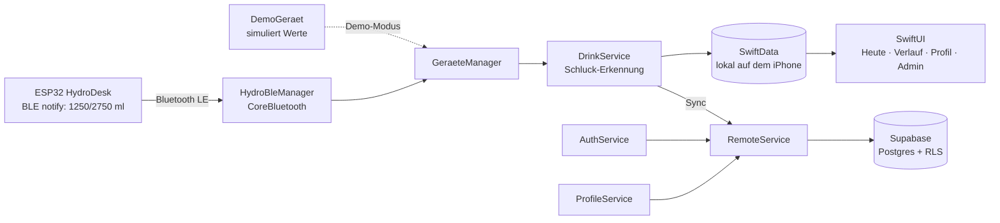

# 📱 HydroDesk App (iPhone)

Begleit-App zum **HydroDesk Base** für das **iPhone**: Das ESP32-Gerät misst mit einer Wägezelle, wie viel du aus
deiner Flasche trinkst, und schickt den Tagesstand per **Bluetooth Low Energy (BLE)** ans Handy.
Die App speichert jeden Schluck, zeigt Fortschritt und Verlauf und synchronisiert alles mit **Supabase**
(Login + Cloud-Datenbank) – mit **denselben Tabellen wie die [Android-App](../app-android/README.md)**.
Wer sich auf Android und iPhone mit demselben Konto anmeldet, sieht dieselben Daten.

> Schulprojekt FI-AE · Swift · SwiftUI (iOS 17+) · SwiftData · Swift Charts · CoreBluetooth · supabase-swift

---

## Inhalt

1. [Was kann die App?](#1-was-kann-die-app)
2. [Ehrlicher Stand: was ist geprüft, was nicht?](#2-ehrlicher-stand-was-ist-geprüft-was-nicht)
3. [Einrichtung Schritt für Schritt](#3-einrichtung-schritt-für-schritt)
4. [In VS Code arbeiten](#4-in-vs-code-arbeiten)
5. [Testen mit dem HydroDesk (Bluetooth)](#5-testen-mit-dem-hydrodesk-bluetooth)
6. [Testen ohne Hardware: Demo-Modus](#6-testen-ohne-hardware-demo-modus)
7. [Admin](#7-admin)
8. [Die 7-Tage-Grenze (kostenlose Apple-ID)](#8-die-7-tage-grenze-kostenlose-apple-id)
9. [So ist die App aufgebaut](#9-so-ist-die-app-aufgebaut)
10. [Test-Checkliste](#10-test-checkliste)
11. [Fehlerbehebung](#11-fehlerbehebung)
12. [Versionen und bekannte Grenzen](#12-versionen-und-bekannte-grenzen)

---

## 1. Was kann die App?

Gleicher Funktionsumfang wie die Android-App. Das Aussehen folgt dem Design aus `HydroDesk_App_UI_Design.pdf`;
alle Maße, Farben und Texte stehen in [`DESIGN_SPEC.md`](DESIGN_SPEC.md) (dort ist auch markiert, was die ursprüngliche
Spezifikation nicht enthielt und ergänzt wurde).

| Bildschirm | Inhalt |
|---|---|
| **Anmelden / Registrieren** | E-Mail + Passwort (Supabase Auth). Die Sitzung bleibt im Schlüsselbund des iPhones gespeichert – nach dem Neustart ist man weiter angemeldet. Zusätzlich **„Ohne Konto testen“** (nur lokal, ohne Supabase). |
| **Heute** | Fortschrittsring mit *heute getrunken / Tagesziel*, „noch … ml“ bzw. „Ziel erreicht“ (mit Häkchen-Symbol), Bluetooth-Status (**Suchen … / Verbunden / Getrennt**), Taste *Verbinden / Trennen*, letzter Schluck, Liste der heutigen Schlucke, Sync-Status. |
| **Verlauf** | Balkendiagramm der letzten 7 Tage (**Swift Charts**, gestrichelte Ziel-Linie, grün = Ziel erreicht) und Liste pro Tag (30 Tage) mit Summe, Anzahl Schlucke und Fortschrittsbalken. **Tipp auf einen Tag** (Karte oder Balken) öffnet die **Tagesseite** mit allen Einträgen dieses Tages; auf „Heute“ führt „… und N weitere“ dorthin. |
| **Profil** | Name, Gewicht (kg), Größe (cm) → **Tagesziel wird live berechnet** (gleiche Formel wie Firmware und Android). Demo-Modus-Schalter, „Jetzt synchronisieren“, Abmelden. |
| **Admin** (nur Rolle `admin`) | Alle Nutzer mit heutiger Trinkmenge und Ziel. Erreichbar über *Profil → Admin: alle Nutzer anzeigen*. |

**Tagesziel** (wie in `wokwi/sketch.ino`, Funktion `zielBerechnen()`):

```
Körperoberfläche (Mosteller)  KOF = √(cm × kg / 3600)
Tagesziel                    = KOF × 1500 ml, auf 50 ml gerundet, Grenzen 1500 … 3500 ml
Beispiel: 70 kg, 175 cm  →  KOF 1,845 m²  →  2767 ml  →  2750 ml
```

*Richtwert, keine medizinische Empfehlung.*

---

## 2. Ehrlicher Stand: was ist geprüft, was nicht?

Die App wurde auf einem **Linux-Rechner ohne Xcode** geschrieben. Dort gibt es kein iOS-SDK. Darum gilt:

| Teil | Stand |
|---|---|
| Logik: Tagesziel, Schluck-Erkennung, BLE-Text-Parser, Verlauf-Berechnung, Profil-Prüfung, Fehlertexte (`HydroDesk/Core/`) | ✅ Mit Swift 6.2 gebaut, **57 Unit-Tests laufen grün** (`swift test`) |
| Supabase-Anbindung (`HydroDesk/Remote/`: Login, Profil, Einträge, Admin-Ansicht) | ✅ Mit Swift 6.2 gegen **supabase-swift 2.55.6** gebaut (Typprüfung, kein Test gegen einen echten Server) |
| Dienste (`AppSettings`, `AuthService`, `ProfileService`, `DemoGeraet`) | ✅ Typprüfung mit Swift 6.2 auf Linux (nicht ausgeführt) |
| SwiftUI-Oberfläche (neues Design), SwiftData, CoreBluetooth, Swift Charts, `DrinkService`, `GeraeteManager` | ✅ **Mit Xcode 26.3 für das iPhone gebaut** (`BUILD SUCCEEDED`) und auf dem iPhone installiert. Wie genau es aussieht, muss man mit dem Design-PDF am Gerät vergleichen (Screenshots im Simulator waren nicht möglich). Nicht geprüft: Dynamic Type AX3 und iPhone SE. |
| `HydroDesk.xcodeproj` | ✅ Mit **XcodeGen** erzeugt (`project.yml`), aber noch nicht in Xcode geöffnet |
| Bluetooth mit dem echten HydroDesk, Login gegen echtes Supabase | ❌ Noch nicht getestet |

**Falls Xcode beim ersten Bauen einen roten Fehler zeigt:** Fehlermeldung (Text oder Screenshot) schicken – das ist dann
ein kleiner Tippfehler im Code und schnell behoben. Das ist normal bei Code, der noch nie von Xcode gesehen wurde.

---

## 3. Einrichtung Schritt für Schritt

### Voraussetzungen

* Ein **Mac** (dein MacBook) mit aktueller macOS-Version.
* **Xcode** (kostenlos im Mac App Store, ca. 10–15 GB). Xcode wird auch gebraucht, wenn du in VS Code arbeitest
  (liefert das iOS-SDK und die Signierung).
* Ein **iPhone mit iOS 17 oder neuer** und ein **USB-Kabel**.
  ⚠️ Der Simulator kann **kein Bluetooth** – dort nur Demo-Modus.
* Eine **Apple-ID** (die normale, kostenlose reicht – siehe [Kapitel 8](#8-die-7-tage-grenze-kostenlose-apple-id)).
* Ein **Supabase**-Projekt. Hast du es für die Android-App schon angelegt (`app-android/README.md`, Schritt 1–3),
  nimm **dasselbe** – dann ist das Schema schon eingespielt.

### Schritt 1 – Xcode installieren

1. **App Store** öffnen → nach **Xcode** suchen → **Laden** (dauert, ist groß).
2. Xcode **einmal öffnen**. Es fragt nach der Lizenz („Agree“) und lädt Zusatzkomponenten – abwarten.
3. Im Terminal (nötig, wenn du später in VS Code arbeitest):

   ```bash
   sudo xcode-select -s /Applications/Xcode.app/Contents/Developer
   sudo xcodebuild -license accept
   ```

### Schritt 2 – Supabase vorbereiten

Nur falls noch nicht für Android gemacht: Projekt anlegen, `app-android/supabase/schema.sql` im SQL Editor ausführen,
„Confirm email“ ausschalten (einfacher zum Testen). Die genauen Klicks stehen in
[`app-android/README.md`](../app-android/README.md), Schritt 1–3.

### Schritt 3 – `Secrets.xcconfig` ausfüllen (URL und Key)

1. In Supabase: **Project Settings → API Keys** (bzw. **Data API**):
   * **Project URL**, z. B. `https://abcdefghijkl.supabase.co`
   * **anon / public** Key (beginnt mit `eyJ…`) **oder** der **Publishable key** (`sb_publishable_…`)
   * ⚠️ **Niemals** den `service_role`- bzw. *Secret*-Key in die App eintragen!
2. Im Ordner `app-ios/` die Vorlage kopieren:

   ```bash
   cd app-ios
   cp Config/Secrets.xcconfig.example Config/Secrets.xcconfig
   ```
3. `Config/Secrets.xcconfig` öffnen und ausfüllen:

   ```
   SUPABASE_URL = https:/$()/abcdefghijkl.supabase.co
   SUPABASE_ANON_KEY = eyJhbGciOi...
   APP_BUNDLE_ID = de.dein-name.hydrodesk
   DEVELOPMENT_TEAM =
   ```

   ⚠️ **Wichtig bei der URL:** In `.xcconfig`-Dateien beginnt `//` einen Kommentar. Darum schreibt man
   `https:/$()/…` – das `$()` zwischen den Schrägstrichen **genau so abtippen**. Die App macht daraus wieder `https://…`.

   * `APP_BUNDLE_ID` muss **weltweit eindeutig** sein, sonst lehnt Apple die Signierung ab.
     Nimm z. B. `de.vorname-nachname.hydrodesk` (nur Kleinbuchstaben, Zahlen, `-` und `.`).
   * `DEVELOPMENT_TEAM` kannst du leer lassen und das Team in Xcode auswählen (Schritt 5).

`Secrets.xcconfig` steht in der `.gitignore` und landet **nicht** auf GitHub. Der anon-Key darf in einer App stehen –
geschützt werden die Daten durch die **Row Level Security** in Supabase, nicht durch den Key.
Nach jeder Änderung die App **neu bauen** (die Werte werden beim Bauen in die Info.plist geschrieben).

### Schritt 4 – Projekt öffnen

1. Im Finder in `app-ios/` auf **`HydroDesk.xcodeproj`** doppelklicken (Xcode öffnet sich).
2. Xcode lädt jetzt automatisch das Swift-Paket **supabase-swift** (unten rechts „Resolving Packages …“, beim ersten
   Mal einige Minuten, Internet nötig). Fertig, wenn links unter „Package Dependencies“ **supabase-swift** steht.
3. Falls Xcode fragt „Trust & Enable“ (Makros/Plug-ins): **Trust & Enable** wählen.

### Schritt 5 – Team und Bundle-ID einstellen (Signierung)

1. Links in der Dateiliste ganz oben auf **HydroDesk** (blaues Symbol) klicken → in der Mitte Target **HydroDesk** →
   Reiter **Signing & Capabilities**.
2. Haken bei **Automatically manage signing**.
3. Bei **Team**: **Add an Account …** → mit deiner Apple-ID anmelden. Danach das Team **„Dein Name (Personal Team)“** wählen.
4. Bei **Bundle Identifier** steht der Wert aus `APP_BUNDLE_ID`. Meldet Xcode *„Failed to register bundle identifier“*,
   ist die ID schon vergeben → in `Secrets.xcconfig` eine andere eintragen (z. B. mit Zahl am Ende).

### Schritt 6 – Entwicklermodus am iPhone einschalten

1. iPhone per **Kabel** an den Mac, am iPhone **„Diesem Computer vertrauen“** → *Vertrauen* und Code eingeben.
2. Am iPhone: **Einstellungen → Datenschutz & Sicherheit → Entwicklermodus** → einschalten → iPhone startet neu →
   nach dem Neustart **Einschalten** bestätigen und Code eingeben.
   (Der Punkt „Entwicklermodus“ erscheint erst, nachdem das iPhone einmal mit Xcode verbunden war.)

### Schritt 7 – App auf dem iPhone starten

1. In Xcode oben in der Mitte neben „HydroDesk“ das **iPhone** auswählen (nicht „Any iOS Device“, nicht Simulator).
2. Auf **▶ Run** klicken (oder `⌘R`). Beim ersten Mal baut Xcode einige Minuten.
3. Meldet Xcode *„Untrusted Developer“*: **Entwickler vertrauen** (Schritt 8).

### Schritt 8 – Entwickler am iPhone vertrauen (nur beim ersten Mal)

Am iPhone: **Einstellungen → Allgemein → VPN & Geräteverwaltung** → unter „Entwickler-App“ deine Apple-ID antippen →
**„Vertrauen“** → bestätigen. Danach die App nochmal in Xcode mit ▶ starten (oder am iPhone das HydroDesk-Symbol antippen).

### Schritt 9 – In der App

1. **Registrieren** (Name, E-Mail, Passwort ≥ 6 Zeichen) oder **Anmelden** – oder erst mal **„Ohne Konto testen“**.
2. **Profil** öffnen: Gewicht und Größe eintragen → **Speichern** → das Tagesziel erscheint auf „Heute“.

---

## 4. In VS Code arbeiten

Du kannst den Code in **VS Code** schreiben und die App von dort aus bauen und aufs iPhone bringen.
**Xcode muss trotzdem installiert sein** (es liefert das iOS-SDK, den Compiler `xcodebuild` und die Signierung).

### Empfohlene Erweiterungen

Beim Öffnen des Ordners schlägt VS Code sie selbst vor (`.vscode/extensions.json`):

| Erweiterung | Wofür |
|---|---|
| **Swift** (`swiftlang.swift-vscode`, vom Swift-Team) | Code-Vervollständigung, Fehler-Anzeige, Debugging von Swift-Paketen |
| **SweetPad** (`sweetpad.sweetpad`) | Bequemer Ersatz für Xcode: Gerät/Simulator wählen, bauen, starten, Logs. Nutzt im Hintergrund `xcodebuild` |

Für SweetPad und die Code-Vervollständigung in der App (nicht nur im Paket) installierst du im Terminal einmalig:

```bash
brew install xcode-build-server xcbeautify
```

Dann in VS Code (SweetPad-Seitenleiste) den Befehl **„SweetPad: Generate Build Server Config“** ausführen.

### Einmalige Einrichtung der Signierung (Xcode-Oberfläche braucht man hier ein Mal)

Das Apple-ID-Konto kann man **nur in der Xcode-Oberfläche** hinzufügen. Der einfachste Weg:

1. Mach **einmal** die Schritte 1–8 oben (Xcode installieren, `Secrets.xcconfig`, Projekt öffnen, Apple-ID und
   *Personal Team* wählen, Entwicklermodus, einmal ▶ Run, Entwickler vertrauen).
2. Danach brauchst du Xcode **nicht mehr zu öffnen**. Xcode hat das Team in das Projekt geschrieben
   (`DEVELOPMENT_TEAM` in `HydroDesk.xcodeproj/project.pbxproj`), und der Rest geht per Terminal / VS Code.

*Alternative ohne Xcode-Oberfläche für das Team:* die 10-stellige Team-ID in `Config/Secrets.xcconfig` bei
`DEVELOPMENT_TEAM =` eintragen. Zu finden mit `defaults read com.apple.dt.Xcode IDEProvisioningTeams`
(Feld `teamID`) – das klappt aber erst, nachdem das Konto in Xcode einmal hinzugefügt wurde.
Das Hinzufügen des Kontos selbst geht nicht per Terminal.

### Bauen und auf dem iPhone starten

Ordner **`app-ios`** in VS Code öffnen (**File → Open Folder**). Dann `⇧⌘B` bzw. **Terminal → Run Task …**
(die Aufgaben stehen in `.vscode/tasks.json`):

| Task | Was passiert |
|---|---|
| **HydroDesk: Secrets.xcconfig anlegen (einmalig)** | Kopiert die Vorlage und öffnet sie |
| **HydroDesk: iPhones anzeigen** | `xcrun devicectl list devices` – zeigt Name und ID deines iPhones |
| **HydroDesk: Bauen (iPhone)** | `tools/bauen.sh` → `xcodebuild … build` |
| **HydroDesk: Auf iPhone installieren und starten** *(Standard, `⇧⌘B`)* | Baut, installiert per `xcrun devicectl device install app` und startet per `xcrun devicectl device process launch`. Fragt nach dem iPhone-Namen. |
| **HydroDesk: Logik-Tests (schnell, ohne Simulator)** | `swift test` – die 57 Unit-Tests der reinen Logik, in Sekunden |
| **HydroDesk: Alle Tests im Simulator** | `tools/test-simulator.sh` → `xcodebuild test` |
| **HydroDesk: Xcode-Projekt neu erzeugen (XcodeGen)** | `xcodegen generate` (nur falls du `project.yml` änderst) |

Dasselbe von Hand im Terminal (Ordner `app-ios`):

```bash
xcrun devicectl list devices                          # iPhone-Name / ID anzeigen
./tools/run-device.sh "Name-deines-iPhones"           # bauen + installieren + starten
```

Voraussetzungen: iPhone per Kabel angeschlossen, entsperrt, Entwicklermodus an, einmal vertraut.
Der Befehl dahinter ist im Kern:

```bash
xcodebuild -project HydroDesk.xcodeproj -scheme HydroDesk -configuration Debug \
  -destination 'generic/platform=iOS' -derivedDataPath build -allowProvisioningUpdates build
xcrun devicectl device install app --device "<iPhone>" build/Build/Products/Debug-iphoneos/HydroDesk.app
xcrun devicectl device process launch --device "<iPhone>" --terminate-existing <deine-bundle-id>
```

> Stand: Die Befehle sind nach der Dokumentation von `xcodebuild` und `devicectl` geschrieben, konnten aber
> auf dem Linux-Rechner **nicht ausprobiert** werden. Meldet eine Aufgabe einen Fehler, den Text weitergeben.

---

## 5. Testen mit dem HydroDesk (Bluetooth)

1. Firmware mit **echtem BLE** muss auf dem CYD laufen (`HYDRO_CYD 1` und `HYDRO_BLE 1`, siehe Haupt-README).
   Das Gerät heißt **`HydroDesk`**.
2. In der App auf **Heute → Verbinden** tippen. Beim ersten Mal fragt iOS: *„HydroDesk möchte Bluetooth verwenden“* →
   **Erlauben**. (Der Text dazu steht in `Info.plist` unter `NSBluetoothAlwaysUsageDescription`.)
3. Status wechselt **Suchen … → Verbinden … → Verbunden**. Darunter steht „Gerät meldet: 1250/2750 ml“.
4. Am Gerät etwas trinken (Flasche abheben und wieder hinstellen) → in der App erscheint ein neuer Schluck mit der Differenz.

**Das Gerät sucht nicht dauerhaft** (Strom sparen): Es ist nur kurz nach dem Einschalten und nach dem Trinken sichtbar.
Findet die App nichts, das HydroDesk kurz aus- und wieder einschalten (oder trinken) und erneut auf *Verbinden* tippen.
Die App sucht 30 s, pausiert 15 s und versucht es automatisch weiter, solange du verbunden sein willst.

**Bluetooth-Daten (müssen mit der Firmware `wokwi/sketch.ino` übereinstimmen):**

| Was | Wert |
|---|---|
| Gerätename | `HydroDesk` |
| Service-UUID | `4f9a0001-6c1e-4b8e-9d6a-2b7c1e0a4d10` |
| Werte-Characteristic (lesen + notify) | `4f9a0002-6c1e-4b8e-9d6a-2b7c1e0a4d10` |
| Format | Text `"1250/2750 ml"` = heute getrunken / Tagesziel (zusätzlich wird `{"heute":1250,"ziel":2750,"akku":88}` verstanden) |

---

## 6. Testen ohne Hardware: Demo-Modus

1. **Profil → Demo-Modus** einschalten.
2. **Heute**: Status „Verbunden (Demo)“. Mit **Schluck simulieren (+200 ml)** kommen sofort 200 ml dazu;
   zusätzlich simuliert die App alle 15–40 s einen zufälligen Schluck (50–300 ml).
3. Der Demo-Modus nutzt dieselbe Schluck-Erkennung, denselben Parser und denselben Sync wie das echte Gerät.
   Die Einträge haben als Quelle `Demo` (in Supabase in `drink_entries.device`).

---

## 7. Admin

Wer in Supabase die Rolle `admin` hat, sieht im **Profil** die Taste **„Admin: alle Nutzer anzeigen“**.
Admin werden: im Supabase-SQL-Editor (E-Mail anpassen)

```sql
update public.profiles set role = 'admin' where email = 'deine@mail.de';
```

Danach in der App neu anmelden (oder einmal Profil neu laden). Normale Nutzer sehen die Taste nicht; selbst wenn,
liefert Supabase (Row Level Security) ihnen nur ihre eigene Zeile.

---

## 8. Die 7-Tage-Grenze (kostenlose Apple-ID)

Apps, die mit einer **kostenlosen Apple-ID** (Personal Team) aufs iPhone gespielt werden, laufen nur **7 Tage**.
Danach startet die App nicht mehr („nicht verfügbar“). Dann:

1. iPhone per Kabel an den Mac, entsperren.
2. In Xcode ▶ Run **oder** in VS Code die Task **„Auf iPhone installieren und starten“** – die App wird neu installiert.
3. Deine **Daten bleiben erhalten** (lokale Datenbank und Anmeldung), solange du die App nicht vorher vom iPhone löschst.
   Was in Supabase liegt, geht ohnehin nicht verloren.

Weitere Grenzen der kostenlosen Apple-ID: höchstens 3 selbst installierte Apps gleichzeitig, und die Bundle-ID
muss eindeutig sein. Mit dem bezahlten Entwicklerprogramm (99 € im Jahr) läuft die App ein Jahr und man kann TestFlight nutzen.

---

## 9. So ist die App aufgebaut

Einfache Schichten mit „manueller Dependency Injection“ (`AppContainer` erzeugt alle Dienste einmal – kein Framework nötig),
dieselbe Idee wie in der Android-App.



```
app-ios/
├── README.md                       ← diese Anleitung
├── DESIGN_SPEC.md                  ← vollständige Design- und Build-Spezifikation (Farben, Maße, Texte, 7 Gerätezustände)
├── HydroDesk.xcodeproj/            ← fertiges Xcode-Projekt (mit XcodeGen erzeugt)
├── project.yml                     ← XcodeGen-Beschreibung (Ausweichlösung, siehe unten)
├── Package.swift                   ← Hilfspaket NUR für `swift test` der reinen Logik
├── Config/
│   ├── Base.xcconfig               ← gemeinsame Einstellungen, bindet Secrets.xcconfig ein
│   └── Secrets.xcconfig.example    ← Vorlage: Supabase-URL/Key, Team, Bundle-ID (echte Datei ist gitignored)
├── tools/                          ← bauen.sh, run-device.sh, test-simulator.sh (für VS Code / Terminal)
├── .vscode/                        ← tasks.json (Bauen/Starten/Tests), extensions.json
├── HydroDesk/
│   ├── Info.plist                  ← u. a. NSBluetoothAlwaysUsageDescription, Supabase-Werte aus Secrets
│   ├── Assets.xcassets/            ← App-Symbol, Akzentfarbe, Farb-Tokens (Light/Dark) aus dem Design
│   ├── HydroDeskApp.swift          ← @main, SwiftData-Container, AppContainer
│   ├── Core/                       ← reine Logik (ohne iOS-Frameworks, getestet)
│   │   ├── GoalCalculator.swift        Tagesziel (Mosteller)
│   │   ├── BlePayloadParser.swift      "1250/2750 ml" → DeviceReading, UUIDs, Status-Texte
│   │   ├── SchluckErkennung.swift      Schluck-Erkennung (wie DrinkRepository in Android)
│   │   ├── Verlauf.swift               Tagessummen, 7-Tage-Balken
│   │   ├── ProfilPruefung.swift        Eingaben prüfen, Ziel-Vorschau
│   │   ├── AuthFehler.swift            Fehlertexte auf Deutsch
│   │   ├── TagDetail.swift             Einträge eines Tages filtern, Tages-Zusammenfassung
│   │   ├── Anzeige.swift               Zielherkunft, Sync-Texte, Gerätekarte (7 Zustände), Prozent
│   │   └── Format.swift                Zahlen/Datum deutsch, Tagesgrenzen
│   ├── Remote/                     ← Supabase (getestet gegen supabase-swift 2.55.6, nur Typprüfung)
│   │   ├── Dtos.swift                  Zeilen der Tabellen profiles, drink_entries, View user_today
│   │   └── RemoteService.swift         Login, Profil, Einträge hoch-/runterladen, Admin-Liste
│   ├── Data/DrinkEntry.swift       ← SwiftData-Modell (ein Schluck)
│   ├── Services/                   ← AppContainer, AppSettings, AuthService, ProfileService,
│   │                                  DrinkService (lokal + Sync), GeraeteManager, DemoGeraet
│   ├── BLE/HydroBleManager.swift   ← CoreBluetooth: suchen, verbinden, notify
│   └── UI/                         ← RootView, StartView, LoginView, HeuteView, GeraeteKarte, VerlaufView, TagDetailView, ProfilView,
│                                      AdminView, Theme (Farben/Karte), Komponenten (Ring, Lichtlinie, Buttons …)
└── HydroDeskTests/                 ← XCTest: Tagesziel, Parser, Schluck-Erkennung, Verlauf, Profil, Fehlertexte
```

**Schluck-Erkennung** (gleich wie Android): Das Gerät schickt nur den **Tagesstand**. Die App merkt sich den letzten Wert:

* Wert steigt (1250 → 1450): neuer Eintrag **+200 ml**.
* Erster Wert des Tages / nach dem Verbinden: Vergleich mit der Summe, die für dieses Gerät heute schon gespeichert ist →
  was ohne Verbindung getrunken wurde, wird **als ein Eintrag nachgetragen**.
* Wert sinkt (Gerät zurückgesetzt): nur neuer Ausgangswert, kein Eintrag.
* Änderungen unter 5 ml werden ignoriert.

**Offline-first + Synchronisierung:** Jeder Schluck wird **zuerst lokal** gespeichert (`synced = false`) und danach per
`upsert` mit derselben UUID zu Supabase hochgeladen (keine Duplikate). Außerdem holt der Sync die Einträge der letzten
30 Tage (z. B. nach Handywechsel). Synchronisiert wird: nach jedem Schluck, beim Öffnen der App, stündlich solange die
App offen ist und auf Knopfdruck („Jetzt synchronisieren“). Auf „Heute“ zeigt das Sync-Symbol (zwei Pfeile im Kreis) vor dem Betrag, dass er noch
nicht hochgeladen ist.

**Tabellen in Supabase** (Schema: [`app-android/supabase/schema.sql`](../app-android/supabase/schema.sql), für beide Apps gleich):
`profiles`, `drink_entries`, Views `daily_totals` und `user_today`.

**Xcode-Projekt neu erzeugen:** `HydroDesk.xcodeproj` kommt aus `project.yml`. Wenn du Dateien/Einstellungen im Projekt
änderst und es neu erzeugen willst: `brew install xcodegen && cd app-ios && xcodegen generate`
(überschreibt das Projekt, auch ein in Xcode gewähltes Team – dann `DEVELOPMENT_TEAM` in `Secrets.xcconfig` eintragen).

---

## 10. Test-Checkliste

**Bauen**
- [ ] `HydroDesk.xcodeproj` öffnet, Swift-Paket supabase-swift wird geladen
- [ ] ⌘B baut ohne rote Fehler
- [ ] ⌘U (oder Task „Alle Tests im Simulator“) – Unit-Tests grün
- [ ] App startet auf dem iPhone

**Login / Konto**
- [ ] Registrieren mit neuer E-Mail → angemeldet (bzw. Hinweis auf Bestätigungs-Mail)
- [ ] In Supabase *Table Editor → profiles* gibt es die neue Zeile mit Name und E-Mail
- [ ] Falsches Passwort → „E-Mail oder Passwort ist falsch.“
- [ ] App komplett schließen und neu öffnen → weiterhin angemeldet
- [ ] Abmelden → Login-Bildschirm

**Profil**
- [ ] 70 kg / 175 cm → Vorschau „Tagesziel: 2.750 ml“
- [ ] Speichern → Meldung, Ziel erscheint auf „Heute“, in Supabase `daily_goal_ml = 2750`
- [ ] Ungültige Werte (z. B. 20 kg) → Fehlermeldung

**Demo-Modus**
- [ ] Demo an → „Verbunden (Demo)“, „Schluck simulieren“ → +200 ml auf „Heute“
- [ ] Eintrag erscheint in Supabase `drink_entries` (Quelle `Demo`)
- [ ] Flugmodus an → Schluck simulieren → ⟳ beim Eintrag → Flugmodus aus → „Jetzt synchronisieren“ → ⟳ verschwindet

**Bluetooth (echtes Gerät)**
- [ ] „Verbinden“ fragt nach der Bluetooth-Berechtigung → Erlauben → „Suchen …“ → „Verbunden“
- [ ] „Gerät meldet: …“ zeigt den Text vom ESP32
- [ ] Trinken am Gerät → neuer Eintrag mit der richtigen Menge
- [ ] Gerät ausschalten → „Getrennt“, wieder einschalten → verbindet automatisch neu
- [ ] Bluetooth am iPhone aus → „Bluetooth ist aus“
- [ ] Ohne Verbindung trinken, dann verbinden → Menge wird nachgetragen

**Verlauf / Admin**
- [ ] Balken für heute passt zur Anzeige auf „Heute“, Ziel-Linie sichtbar, grün bei erreichtem Ziel
- [ ] Normaler Nutzer: keine Admin-Taste; mit Rolle `admin`: Liste zeigt alle Nutzer
- [ ] Zweites Konto sieht die Einträge des ersten **nicht**

---

## 11. Fehlerbehebung

| Problem | Lösung |
|---|---|
| „Supabase ist noch nicht eingerichtet“ (roter Kasten beim Login) | `Config/Secrets.xcconfig` fehlt oder enthält noch die Platzhalter. Ausfüllen, dann **Product → Clean Build Folder** (⇧⌘K) und neu bauen. |
| Supabase-URL funktioniert nicht | In der URL muss `https:/$()/…` stehen (siehe Schritt 3), nicht `https://…` – sonst schneidet Xcode alles hinter `//` ab. |
| „Failed to register bundle identifier“ / „No profiles for … were found“ | `APP_BUNDLE_ID` ist schon vergeben → in `Secrets.xcconfig` eine eigene, eindeutige ID eintragen. |
| „Signing requires a development team“ | In **Signing & Capabilities** das **Personal Team** wählen (Schritt 5) oder `DEVELOPMENT_TEAM` eintragen. |
| iPhone erscheint nicht in der Geräteliste | Kabel prüfen, iPhone entsperren, „Vertrauen“ bestätigen, **Entwicklermodus** einschalten (Schritt 6). |
| „Untrusted Developer“ am iPhone | Einstellungen → Allgemein → VPN & Geräteverwaltung → Entwickler vertrauen (Schritt 8). |
| App startet nicht mehr nach einer Woche | 7-Tage-Grenze, siehe [Kapitel 8](#8-die-7-tage-grenze-kostenlose-apple-id): neu installieren. |
| Status bleibt „Suchen …“ | HydroDesk kurz aus-/einschalten oder trinken (es sucht nur kurz). Firmware mit `HYDRO_BLE 1` gebaut? Bluetooth am iPhone an? |
| „Keine Berechtigung“ | Taste „iPhone-Einstellungen öffnen“ → Bluetooth für HydroDesk erlauben. |
| Hinweis „Trust & Enable“ / Makro-Fehler | In Xcode **Trust & Enable** wählen; im Terminal ist `-skipMacroValidation` schon in `tools/bauen.sh` gesetzt. |
| Paketfehler beim Laden von supabase-swift | Internet prüfen, **File → Packages → Reset Package Caches**, dann **Resolve Package Versions**. Die App ist auf **Version 2.55.6** festgelegt (diese Version wurde geprüft). |
| Roter Swift-Fehler beim ersten Bauen | Meldung kopieren und weitergeben (siehe [Kapitel 2](#2-ehrlicher-stand-was-ist-geprüft-was-nicht)). |
| `xcodebuild` / `devicectl`: „command not found“ oder Lizenz-Hinweis | Schritt 1, Punkt 3 (`xcode-select`, `-license accept`) im Terminal ausführen. |
| VS Code: `swift test` findet nichts | Ordner **`app-ios`** öffnen (nicht den ganzen Repo-Ordner) und Xcode installiert haben. |

Logs ansehen: Xcode → unten **Debug-Konsole**, oder Konsolen-App am Mac (Filter `subsystem:de.hydrodesk`).

---

## 12. Versionen und bekannte Grenzen

| Komponente | Version / Stand |
|---|---|
| iOS-Mindestversion | **17.0** (SwiftUI-Observation, SwiftData, Swift Charts) |
| Xcode | aktuelle Version aus dem App Store (Projekt im Format von Xcode 16 oder neuer) |
| Swift-Sprachmodus | Swift 5 (bewusst, damit keine strengen Nebenläufigkeits-Fehler stören) |
| supabase-swift | **2.55.6** (fest eingestellt, geprüft) |
| Unit-Tests | 57, in `HydroDeskTests/` (laufen mit `swift test` und in Xcode mit ⌘U) |

**Bekannte Grenzen / Ideen für später**

* **Kein Hintergrund-Sync wie WorkManager** bei Android: Auf dem iPhone wird hochgeladen, solange die App offen ist
  (und beim nächsten Öffnen). Die Bluetooth-Verbindung kann dank des Eintrags `bluetooth-central` (`UIBackgroundModes`)
  im Hintergrund weiterlaufen, solange iOS die App nicht beendet – das ist **nicht getestet**.
  Der ESP32 zählt selbst weiter, beim nächsten Verbinden werden fehlende ml nachgetragen.
* Das Tagesziel wird (noch) nicht ans Gerät übertragen – dafür bräuchte die Firmware eine beschreibbare Characteristic.
* Einträge können in der App nicht gelöscht werden (geht im Supabase-Dashboard).
* Nur Hochformat auf dem iPhone, kein iPad-Layout.
